
<a href="https://canessasyslabs.com"></a>

<b>Software, AI agents and skill systems with a stricter standard: every product keeps a record of what it did, what it checked and what still needs a human decision.</b>


<a href="https://github.com/Canessa-System-Labs/digital-career-portfolio"></a>
<a href="https://github.com/Canessa-System-Labs/exedrion"></a>

<a href="https://github.com/Canessa-System-Labs/cetus"></a>
<a href="https://github.com/Canessa-System-Labs/tabularium"></a>

<a href="https://github.com/Canessa-System-Labs/aletheion"></a>
<a href="https://github.com/Canessa-System-Labs/nomic"></a>

<a href="https://github.com/Canessa-System-Labs/phonosphere"></a>
<a href="https://github.com/Canessa-System-Labs/omniscribe"></a>

Implementation stays private. Each showcase presents the problem, the idea, how it works and the evidence, released through a reviewed gate.

<a href="https://canessasyslabs.com/#projects"></a>


<a href="https://github.com/Canessa-System-Labs/community-plugins"></a>

Free for noncommercial use. Add the marketplace once, then install: <code>/plugin marketplace add Canessa-System-Labs/community-plugins</code> · <a href="https://github.com/Canessa-System-Labs/community-plugins#installation-manual">Installation manual</a>

<a href="https://canessasyslabs.com"></a>

© Canessa System Labs. All rights reserved. This repository presents the work; it does not license it. No part of its text, images or design may be reused without written permission.

