<b>Software, AI agents and skill systems with a stricter standard: every product keeps a record of what it did, what it checked and what still needs a human decision.</b>

Implementation stays private. Each showcase presents the problem, the idea, how it works and the evidence, released through a reviewed gate.

© Canessa System Labs. All rights reserved. This repository presents the work; it does not license it. No part of its text, images or design may be reused without written permission.

